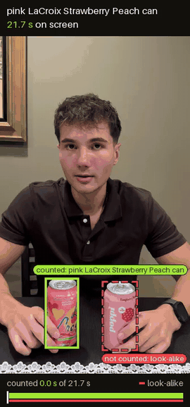
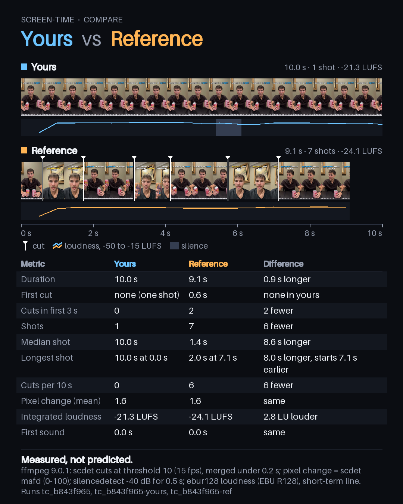

# Screen-Time for Hermes

**Ask Hermes how long your product is on screen in a video. Get the seconds, each contract term checked against the
frames that prove it, and a proof reel back in the chat.**

Brands pay creators for screen time. Screen-Time measures it: it tracks every object of the right kind through every
frame of the video (15 frames a second), checks each one against the product so a different flavour or a rival can is
not counted, and checks plain-English terms such as "on screen at least 3 seconds" as typed rules. A second mode,
Compare, measures a creator's draft against a reference take, shot by shot.

<p>
  
  
</p>

## Try it in one minute

```
hermes plugins install aldot311/hermes-screentime
```

Then, in any Hermes chat:

```
/screentime demo
```

The demo runs the whole Measure pipeline on a bundled clip with a recorded Meta API run, so it needs no key and costs
nothing. `/screentime selftest` checks ffmpeg and the cut detector on a generated clip. Screen-Time needs `ffmpeg` on
your PATH (`brew install ffmpeg` or `apt install ffmpeg`).

## Measure

Attach a video (and, if you have one, a photo of the product) and ask in plain words:

> How long is the pink LaCroix Strawberry Peach can on screen? Terms: at least 3 s in total, shown in the first 2 s,
> say LaCroix out loud.

Hermes calls `screentime_measure` and replies with:

- seconds on screen, share of the video, first seen, longest continuous run, size in frame
- every tracked object with its verdict: counted, look-alike (not counted, with the reason) or unclear (not counted)
- each term as PASS, FAIL or NEEDS A PERSON, with the moment that proves it
- a proof reel: the video with a lime box on what counted, a dashed red box on what did not, and a timeline strip

How it works: ffmpeg normalizes the video to 15 fps, so a frame number divided by 15 is an exact second. Meta's SAM 3.1
tracks every object matching a plain noun ("drink can") with a box and a mask per frame. Muse Spark looks at crops of
each tracked object next to the product photo and decides: match, look-alike or unclear. Only matches count. Muse Voice
Transcribe listens for the brand name. The terms are checked by code, not by a model.

Measure uses your own Meta Model API key: paste it in Settings > Plugins > screentime (Hermes stores it; it never goes
in config.yaml). It costs about $0.003 per second of video for tracking plus about $0.02 per checked object. The plugin
reserves each call's cost before making it and refuses to pass your caps (defaults: $0.50 per video, $5 per day).

Without a Meta key, the product check can run on your own Hermes vision model instead (set the `screentime_verify`
task, which inherits your vision model by default). Reports say which model checked the objects and whether that
configuration was validated.

## Compare

> Compare my draft with this reference.

`screentime_compare` measures both videos with ffmpeg only: cuts, first cut, cuts in the first 3 seconds, shot
lengths, pixel change per shot, loudness, first sound and silences. It returns a card with both filmstrips on one time
axis and a table of differences in neutral words ("your first cut lands 1.5 s later"). No key, no network, no cost.
If the same file was measured before in that chat, product and brand timing are included.

It measures; it does not predict. There is no score, no retention curve and no "virality".

## Accuracy

Measured with the plugin itself on 11 human-labelled test Reels (2,800 frames at 15 fps), frame by frame:

| | Precision | Recall | F1 |
|---|---|---|---|
| SAM 3.1 alone | 95.0% | 99.6% | 97.2% |
| With the product check | **98.1%** | **81.7%** | 89.1% |

On the Reel with only a look-alike can, SAM alone counts 4.3 s and Screen-Time counts 0.0 s. The 3-second term was
right on 8 Reels, sent to a person on 2 and wrong on 1. It is cautious on purpose: a can too small or blurred to confirm
is not counted, so on two Reels it reports 0.0 s and asks a person instead of failing the creator. Where it is wrong,
and the comparison with the original app: [docs/ACCURACY.md](docs/ACCURACY.md). The whole run cost $0.63.

## What leaves your machine

- Measure only, with your key: the normalized video (uploaded to Meta's Files API with a one-hour expiry and deleted
  after the run), crops of tracked objects and the product photo (Muse Spark), and the audio (Voice Transcribe).
- When the product check uses your Hermes model, the crops go to that model's provider.
- Compare and the demo make no network calls.
- The plugin runs ffmpeg and ffprobe on the files you name, reads only files under your session folder, your home
  folder or Hermes's home, keeps its run index in Hermes's plugin data folder and writes proof reels and cards to
  Hermes's generated-media cache. No background processes, no telemetry.

## Credits

Ported from Screen-Time, built for Meta's hackathon (Oct 28 to Nov 4, 2026). Compare's shot measurement follows the
same idea as the open `video-shot-breakdown` skill (PR #109645); Screen-Time adds the comparison with a reference and the
product and brand timing.

License: MIT for the code. The bundled demo clip is the builder's own footage. `meta-sam-parser` is Meta's SAM License.
